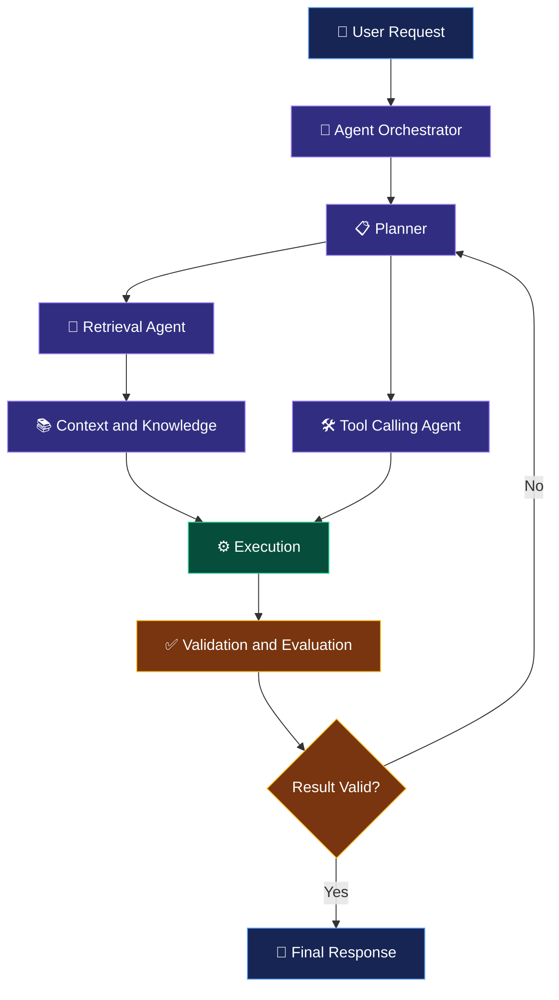
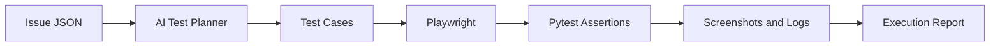
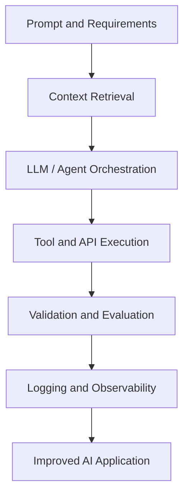

 <!-- ================= HERO SECTION ================= -->

<h1 align="center">👋 Hi, I'm Md Aamir</h1>

<h3 align="center">🤖 AI Engineer | Generative AI | Agentic AI | Automation</h3>

<p align="center">
  
</p>

<p align="center">
  
  
  
</p>

<p align="center">
  <a href="https://linkedin.com/in/md-aamir2712">
    
  </a>
  <a href="mailto:mdaamir2712@gmail.com">
    
  </a>
  <a href="https://github.com/mdaamir6870">
    
  </a>
</p>

<p align="center">
  
</p>

<!-- ================= AGENTIC AI LAB ================= -->

<h2>🤖 01. Inside My Agentic AI Lab</h2>

<p>
  Exploring how LLMs, retrieval systems, tools, and evaluation work together to build intelligent AI applications.
</p>

<p align="center">
  
  
  
  
</p>

<details open>
<summary><b>🧠 Explore the Agentic AI Architecture</b></summary>

<br/>



**Architecture components**

| Component | Responsibility |
|---|---|
| Planner | Break a task into manageable steps |
| Retrieval | Retrieve relevant information and context |
| Tool Calling | Select and invoke appropriate tools |
| Execution | Run application or API operations |
| Validation | Check outputs against requirements |
| Evaluation | Assess quality, correctness, and reliability |

*This is a conceptual architecture for learning and design. It does not imply that every component is already implemented in a deployed multi-agent system.*

</details>

<details>
<summary><b>⚙️ Technologies Behind the Workflow</b></summary>

- **LLM integration:** OpenAI API, Hugging Face models
- **Orchestration:** LangChain, LangGraph
- **Retrieval:** FAISS, Sentence Transformers, embeddings
- **Application layer:** Python, FastAPI, Streamlit
- **Testing:** Pytest, Playwright
- **Engineering practices:** Structured outputs, logging, evaluation, error handling

</details>

---

<!-- ================= AUTOMATION ACTIVITY ================= -->

<h2>⚡ 02. Automation in Action</h2>

<p>Designing AI-assisted workflows that connect requirements, intelligent planning, browser actions, and test validation.</p>

```text
╭─────────────────────────────────────────────────────╮
│           AI AUTOMATION CONTROL CENTER              │
├─────────────────────────────────────────────────────┤
│                                                     │
│  [01] REQUIREMENTS       → ANALYZE                  │
│  [02] AI TEST PLANNER    → GENERATE TEST PLAN       │
│  [03] PLAYWRIGHT         → EXECUTE BROWSER ACTIONS  │
│  [04] PYTEST             → VALIDATE RESULTS         │
│  [05] REPORTING          → SAVE EVIDENCE            │
│                                                     │
╰─────────────────────────────────────────────────────╯
```

<details open>
<summary><b>🖥️ Sample Agent Execution Logs</b></summary>

```text
[AGENT]      Requirement received
[PLANNER]    Test plan preparation requested
[TOOL]       Browser automation selected
[EXECUTOR]   Playwright workflow requested
[VALIDATOR]  Acceptance criteria verification
[REPORT]     Evidence and execution report preparation
```

> These are illustrative sample logs, not a live execution stream. Actual execution results should come from the running application.

</details>

<details>
<summary><b>🔬 Autonomous UI Testing Agent — Workflow</b></summary>



**Technology stack:** Python · OpenAI API · Playwright · Pytest · JSON

**Current limitations:** End-to-end execution is pending. GitHub webhook integration is not implemented.

</details>

---

<!-- ================= ABOUT ME ================= -->

<h2>👨‍💻 03. About Me</h2>

I'm Md Aamir, an MSc Data Science graduate focused on developing practical AI applications and intelligent automation systems.

My interests span Generative AI, Large Language Models, retrieval-augmented generation, AI agent workflows, and reliable AI-powered software testing.

I enjoy exploring how AI can move beyond generating text to retrieving knowledge, using tools, completing structured tasks, and validating outcomes.

- 🎓 **Education:** MSc Data Science
- 🤖 **Primary focus:** AI Engineering and Agentic AI
- 🧠 **Core interests:** LLMs, RAG, embeddings, and agent orchestration
- ⚙️ **Application development:** Python, APIs, and AI automation
- 🧪 **Quality engineering:** Playwright, Pytest, and test evaluation
- 🚀 **Goal:** Build reliable, maintainable, real-world AI applications

---

<!-- ================= TECH STACK ================= -->

<h2>🛠️ 04. AI Engineering Tech Stack</h2>

<h3>💻 Programming and Data Science</h3>

<p>
  
</p>

`Python` · `SQL` · `Pandas` · `NumPy` · `Statistics`

<h3>🤖 Generative AI and Agentic AI</h3>

<p>
  
  
  
  
  
</p>

`LLMs` · `Prompt Engineering` · `Function Calling` · `Structured Outputs` · `Agent Workflows` · `LLM Evaluation`

<h3>🔎 RAG and Vector Search</h3>

<p>
  
  
  
</p>

`Chunking` · `Embeddings` · `Semantic Search` · `Metadata Filtering` · `Hybrid Search` · `Reranking`

<h3>🌐 Backend and Applications</h3>

<p>
  
</p>

`REST APIs` · `Application Integration` · `Deployment` · `Logging` · `Monitoring`

<h3>🧪 AI Automation and Testing</h3>

<p>
  
  
  
</p>

`Test Planning` · `Assertions` · `Screenshots` · `Test Reports` · `Workflow Automation`

<h3>📊 Machine Learning and NLP</h3>

<p>
  
</p>

`Machine Learning` · `Deep Learning` · `NLP` · `XGBoost` · `Time-Series Forecasting`

---

<!-- ================= PROJECTS ================= -->

<h2>🚀 05. Featured Projects</h2>

<h3>🤖 1. Autonomous UI Testing Agent</h3>

**AI-assisted browser testing and workflow automation**

An AI-assisted testing project designed to translate requirements into test plans, automate browser interactions, verify acceptance criteria, and prepare execution evidence.

**Workflow:** Requirements → AI Test Planning → Playwright → Pytest → Evidence

**Tech stack:** `Python` `OpenAI API` `Playwright` `Pytest` `JSON`

**Status:** In development. End-to-end execution is pending, and GitHub webhook integration is not implemented.

<h3>🔎 2. RAG-Based Knowledge Assistant</h3>

A retrieval-augmented question-answering application concept focused on retrieving relevant document context before generating answers.

**Workflow:** Documents → Chunking → Embeddings → Vector Search → LLM Response

**Tech stack:** `Python` `LangChain` `FAISS` `Sentence Transformers`

**Status:** Concept / implementation status to be updated.

<h3>💬 3. Generative AI Sales Chatbot</h3>

A conversational AI concept for answering product-related questions and supporting intelligent customer interactions.

**Tech stack:** `Python` `LLMs` `LangChain` `LlamaIndex`

**Status:** Planned / implementation status to be updated.

<h3>🌧️ 4. Urban Rainfall Analysis and Prediction</h3>

A data science project analyzing urban rainfall patterns using geospatial datasets and exploring time-series forecasting with LSTM.

**Data sources:** GPM IMERG · MERRA-2 · Google Earth Engine

**Tech stack:** `Python` `Pandas` `Geospatial Analysis` `LSTM`

**Status:** Research / analytical project.

<p align="center">
  <a href="https://github.com/mdaamir6870?tab=repositories">
    
  </a>
</p>

---

<!-- ================= ENGINEERING PRINCIPLES ================= -->

<h2>🔬 06. From Prompt to Production</h2>



<details>
<summary><b>📌 My AI Engineering Principles</b></summary>

- **Grounded responses:** Retrieve relevant context when appropriate.
- **Structured outputs:** Use predictable data formats for application integration.
- **Tool safety:** Validate inputs and handle failures.
- **Evaluation:** Test correctness, relevance, and task completion.
- **Observability:** Capture useful logs and execution evidence.
- **Maintainability:** Keep code modular, testable, and documented.

</details>

---

<!-- ================= GITHUB ANALYTICS ================= -->

<h2>📊 07. GitHub Analytics</h2>

<p align="center">
  
  
</p>

<p align="center">
  
</p>

<h3 align="center">🐍 Contribution Activity</h3>

<p align="center">
  <picture>
    <source media="(prefers-color-scheme: dark)" srcset="https://raw.githubusercontent.com/Platane/snk/output/github-contribution-grid-snake-dark.svg"/>
    <source media="(prefers-color-scheme: light)" srcset="https://raw.githubusercontent.com/Platane/snk/output/github-contribution-grid-snake.svg"/>
    
  </picture>
</p>

<p align="center">
  <i>Analytics depend on GitHub data availability and external image services.</i>
</p>

---

<!-- ================= CONNECT ================= -->

<h2 align="center">🤝 Let's Connect</h2>

<p align="center">
  I'm interested in AI engineering, Generative AI, agentic workflows, and building useful intelligent applications.
</p>

<p align="center">
  <a href="https://linkedin.com/in/md-aamir2712">
    
  </a>
  <a href="mailto:mdaamir2712@gmail.com">
    
  </a>
  <a href="https://github.com/mdaamir6870">
    
  </a>
</p>

<p align="center">
  
</p>

<h3 align="center">⚡ Building reliable AI systems that reason, retrieve, use tools, and automate real workflows.</h3>

<p align="center">
  <i>Learn continuously. Build practically. Validate everything.</i>
</p>
